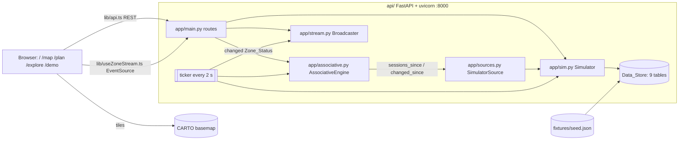

# Design Document: SpotStack (parking-monitor)

## Overview

SpotStack ("South Bethlehem & Lehigh parking, live") estimates where, when, and for how long parking is free around South Bethlehem and the Lehigh campus, using pay-by-hour payment sessions instead of sensors. The local build runs on one laptop as two processes. A FastAPI service on port 8000 holds the data, the simulator, the associative engine, and the live stream. A Next.js web app runs on port 3000. All data is synthetic and generated at startup from one seed fixture (Req 20).

Locked decisions:

- **Occupancy** is active sessions ÷ capacity, from raw sessions, with no correction factor or confidence band (Req 5.2).
- **Prediction** is the hour-of-week baseline × the largest event boost, clamped to 1.0. It is plain arithmetic: numpy handles array math only, and no ML library is used (Req 6).
- **One process, no database.** The in-process Data_Store holds nine tables that map 1:1 to the deferred Supabase schema (Req 1). Server-Sent Events on `/stream` replace Supabase Realtime (Req 15.2–15.5).
- **Qlik-style associative exploration** replaces the old Insights page (Req 10–12).
- **No chart library.** Charts and the heatmap are hand-built accessible HTML/SVG buttons. This is a deliberate deviation from Recharts/shadcn in `information.xml`: fewer dependencies, and full control of 44 px targets and accessible names (Req 12.13, 17.4).
- **No authentication in the local build**, including on `POST /demo/scenario`. Anyone who can reach port 8000 can trigger scenarios. uvicorn binds to `127.0.0.1` by default, and access control is required before any deployment.

## Architecture



### Repository Layout

```
fixtures/build_seed.py → fixtures/seed.json   # deterministic seed generator and shared fixture (Req 2.1)
api/pyproject.toml     # Python 3.13 via uv; fastapi, uvicorn, numpy pinned; dev: pytest, httpx, hypothesis pinned
api/app/data.py        # seed loading, DataStore, TZ, hour_of_week, haversine_m, walk_minutes, applicable_rule
api/app/events.py      # Event_Template expansion relative to the start date
api/app/sim.py         # Simulator: history, live advance, Zone_Status, prediction, scenarios
api/app/sources.py     # SessionSource Protocol + SimulatorSource
api/app/associative.py # AssociativeEngine
api/app/stream.py      # SSE Broadcaster
api/app/main.py        # create_app(sim=None, clock=None, run_ticker=True)
api/tests/             # pytest + hypothesis
web/app/               # routes / (Home), /map, /plan, /explore, /demo (Next.js 16.4.2 App Router, React 19, TS)
web/lib/api.ts         # typed client; base URL NEXT_PUBLIC_API_URL, default http://localhost:8000 (Req 20.6)
web/lib/useZoneStream.ts, web/lib/format.ts
web/components/        # AppShell, ZoneMap (Leaflet 1.9.4, client-only), ApiError, Dial, charts
web/scripts/check-contrast.mjs
docs/integration.md, docs/demo-script.md, README.md (Devpost format)
.env.example           # SEED_PATH, SIM_RNG_SEED, HISTORY_DAYS, CORS_ORIGINS, NEXT_PUBLIC_API_URL (names only, Req 20.7)
```

Commands (Req 19.2, 20.1, 20.2, 20.8):

| Purpose | Directory | Command |
|---|---|---|
| Start the API | `/api` | `uv run uvicorn app.main:create_app --factory --port 8000` |
| Start the web app | `/web` | `npm run dev` |
| Run the API tests | `/api` | `uv run pytest` |
| Run the web checks | `/web` | `npm run check` (`tsc --noEmit && eslint . && node scripts/check-contrast.mjs`) |

### Startup and Runtime

The `create_app` lifespan runs these steps:

1. Load `SEED_PATH` (default `../fixtures/seed.json`) into a `DataStore` and call `validate()`.
2. Expand the event templates relative to today's local date (Req 4).
3. Run `Simulator.generate_history()`. It simulates `HISTORY_DAYS` (default 28) in 5-minute steps up to `clock()`, then computes baselines (Req 3.1, 6.1). The budget is under 15 s, against the 30 s limit (Req 20.5).
4. Run `AssociativeEngine.load(source)` (Req 10.1).
5. If `run_ticker` is set, start an asyncio task. Every 2 s it runs `await asyncio.to_thread(sim.advance_to, clock())`, publishes the changed Zone_Status rows to the Broadcaster, and calls `engine.sync()` (Req 3.13, 5.6, 10.12, 15.4).

Tests use `create_app(sim=small_sim, clock=fake_clock, run_ticker=False)`.

### Deferred Deploy Path

The `claude output/Hackathon` scaffold is the reference for the later deploy phase: Supabase migrations, RLS, the Realtime publication, `fly.toml`, and CI. Local tables map 1:1 to scaffold tables, with these deltas:

| Local | Scaffold | Migration note |
|---|---|---|
| `Session` | `parking_session` | rename; add nullable `event_id` FK if absent |
| `Operator`, `Zone_Status`, … | lowercase snake case | names only |
| `Zone_Status.Occupied` (ratio) + `Active_Sessions` | `zone_status.occupied int` (count) | the count moves to `active_sessions`; `occupied` becomes a `numeric` ratio |
| `Zone.Note`, `Rate_Rule.placeholder`, `Rate_Rule.source` | absent | add columns |
| `Operator.Pay_App` list | text | `text[]` |
| SSE `/stream` | Realtime on `zone_status` | swap the web hook implementation |

## Components and Interfaces

### Seed Fixture (`fixtures/build_seed.py` → `fixtures/seed.json`)

`build_seed.py` writes a single JSON document with these keys: `operators`, `facilities`, `zones`, `rate_rules`, `destinations`, `event_templates`, `demand_curves`, `profiles`, and `scenarios`.

- **Times** are `"HH:MM"` local strings, and `"24:00"` means end of day.
- **`day_of_week`** uses 0 for Monday, which is Postgres `ISODOW - 1`.
- **`Hour_Of_Week`** is `day_of_week*24 + hour`.

```json
{"operators": [{"operator_id": "bpa", "name": "Bethlehem Parking Authority", "pay_app": ["ParkMobile", "PayByPhone"]},
               {"operator_id": "lps", "name": "Lehigh Parking Services", "pay_app": ["Passport Parking"]}],
 "rate_rules": [{"rule_id": "bpa-e3rd-west-mon", "zone_id": "bpa-e3rd-west", "day_of_week": 0, "start": "08:00", "end": "21:00",
                 "hourly_rate": 2.50, "time_limit_min": 120, "placeholder": false, "source": "ParkBethlehem RapidPark rates (bethpark.org)"}],
 "event_templates": [{"template_id": "football", "name": "Lehigh Football Home Game", "destination_id": "goodman",
                      "rule": {"kind": "alternate_saturdays", "start": "12:00", "end": "16:00"}, "expected_attendance": 12000,
                      "impacts": {"lps-packer-ave": 1.6, "lps-farrington": 1.4, "bpa-polk-garage": 1.3, "bpa-e3rd-west": 1.2}}],
 "demand_curves": {"bpa-e3rd-west": [0.0, "... 168 values ..."]},
 "scenarios": {"game_day": {"template_id": "football", "event_name": "Game Day (Live Demo)", "duration_min": 45},
               "family_weekend": {"template_id": "family_weekend", "event_name": "Family Weekend (Live Demo)", "duration_min": 45}}}
```

Zone catalog (capacities marked * are placeholders):

| zone_id | Zone | Rule (local) | Cap | Visitor | Profile | Placeholder |
|---|---|---|---|---|---|---|
| bpa-main-st | Main St RapidPark | $2.50, 120 min, Mon–Sat 08–21 (Req 2.3) | 40* | yes | core_long | no |
| bpa-e3rd-west / -east | E 3rd St RapidPark West / East | same | 45* each | yes | core_long | no |
| bpa-e4th | E 4th St RapidPark | same | 35* | yes | short_stay | no |
| bpa-new-st | New St FlexPark | $1.50, 180 min, Mon–Sat 08–21 (Req 2.4) | 30* | yes | short_stay | no |
| bpa-morton | Morton Ave FlexPark | same | 30* | yes | quiet | no |
| bpa-polk-garage | Polk Street Garage | $1.00, no limit, daily 06–24 | 731 (Req 2.7) | yes | garage_commuter | yes |
| bpa-new-st-garage | New Street Garage (324 S New St) | $1.00, no limit, daily 06–24 | 400* | yes | garage_commuter | yes |
| lps-zoellner-l1 | Zoellner Garage Level 1 | $1.00, no limit, daily 07–23 (Req 2.8) | 60* | yes | visitor_garage | start hour |
| lps-zoellner-l2…l4 | Zoellner Garage Levels 2–4 | $0.00 permit model, Mon–Fri 07–17 (Req 2.9) | 120* each | no | permit | yes |
| lps-farrington | Farrington Square Lower Level | $1.00, no limit, daily 06–24 (Req 2.10) | 52 | yes | visitor_garage | no |
| lps-packer-ave | Packer Ave Meters | $1.00, 120 min, Mon–Fri 07–17 (Req 2.12) | 25* | yes | campus_meter | yes |
| lps-alumni-l1 | Alumni Garage Level 1 Meters | $1.00, 120 min, Mon–Fri 07–17 | 30* | yes | campus_meter | yes |

Seed notes:

- **BPA on-street zones:** every Note says pay stations are accepted alongside ParkMobile and PayByPhone (Req 2.5).
- **Farrington:** the Note covers Text2Park after 16:00 and on weekends (Req 2.11).
- **Permit levels:** use $0 sessions with the Note "Permit holders only. Visitors use Level 1." This keeps the map from showing a misleading "100% free".
- **Sources:** rules with `placeholder: false` carry a `source` (Req 2.13, 2.14).
- **Destinations:** the four Destinations carry lat/lng (Req 2.15).

| Profile | Curve peak (window) | Paid-duration mean | Purpose |
|---|---|---|---|
| core_long | 0.90 (Mon–Sat 10–18), 0.5 evenings | `0.95 × limit` | ≥0.85 occupancy, lowest turnover (Req 3.9, 3.10) |
| short_stay | 0.65 | 45 min | high-turnover comparators |
| quiet | 0.32 | 45 min | ≤0.40 occupancy (Req 3.11) |
| garage_commuter | 0.60 weekdays | 240 min | garages |
| visitor_garage | 0.55 + evening/weekend bumps | 120 min | Zoellner L1, Farrington |
| campus_meter | 0.80 (class hours) | `0.6 × limit` | Packer, Alumni |
| permit | 0.75 (Mon–Fri 08–16) | 300 min | Zoellner L2–L4 |

Each zone's demand curve has 168 values (Req 2.16), shaped by three rules:

- **Unenforced hours** are 0.0, except the first hour after enforcement ends, which gets 0.1 × the previous hour.
- **The first enforced hour** is at most 0.40.
- **Consecutive enforced hours** differ by at most 0.15.

Together these keep the controller's hour-mean error inside the 0.10 tolerance (Req 3.7).

### `app/data.py` and `app/events.py`

```python
TZ = ZoneInfo("America/New_York")
def hour_of_week(ts: datetime) -> int            # requires aware ts; local weekday()*24 + hour (Req 1.13)
def haversine_m(lat1, lng1, lat2, lng2) -> float  # R = 6_371_008.8 m
def walk_minutes(distance_m: float) -> int       # math.ceil(distance_m * 1.3 / 80) (Req 9.4)
def applicable_rule(store, zone_id, ts) -> RateRule | None  # day_of_week match and start <= local minute < end
def load_seed(path) -> DataStore                  # validate(): FKs, Impacts PK uniqueness, one Zone_Status per Zone (Req 1.12)
def expand_events(templates, today, history_start, horizon_days=28) -> tuple[list[Event], list[Impact]]
```

A zone is a Time_Limited_Zone at `t` when `applicable_rule(...).time_limit_min is not None`.

`expand_events` covers `[history_start, today + 28 days]` (Req 4.1, 4.5) and generates three event types:

- **Football:** Saturdays 12:00–16:00, on anchor ± 14k days, where the anchor is the first Saturday on or after `today` (Req 4.2).
- **Zoellner performances:** every Friday and Saturday, 19:30–22:00 (Req 4.3).
- **Family Weekend:** exactly one, from Saturday 09:00 at anchor + 7 days (7–13 days out) through Sunday 17:00 (Req 4.4).

Each event gets one Impacts row per template zone, carrying the template's boost (≥ 1.0) (Req 4.6, 4.7). IDs are deterministic, such as `football-2026-11-07`.

### `app/sim.py`: Simulator

```python
class Simulator:
    def __init__(self, store: DataStore, *, start: datetime, history_days: int = 28,
                 rng_seed: int | None = 7, step_min: int = 5): ...
    def generate_history(self) -> None
    def advance_to(self, now: datetime) -> list[ZoneStatus]          # rows whose values changed
    def zone_status(self) -> dict[str, ZoneStatus]
    def event_boost(self, zone_id: str, t: datetime) -> tuple[float, Event | None]
    def baseline(self, zone_id: str, how: int) -> float
    def predict(self, zone_id: str, t: datetime) -> Prediction
    def opening_soon_counts(self, t: datetime) -> dict[str, int]
    def apply_scenario(self, name: str, now: datetime) -> ScenarioResult   # raises UnknownScenario
    def scenario_status(self, now: datetime) -> ActiveScenario | None
    def add_listener(self, fn: Callable[[list[int], list[int]], None]) -> None  # (new keys, changed keys)
```

All randomness comes from `numpy.random.default_rng(rng_seed)`. Identical seed, Seed_Data, and start produce identical output (Req 3.14). `SIM_RNG_SEED` defaults to 7 so the demo can be repeated.

**Arrival controller.** Runs per zone per step `[t, t+dt)`. Steps are 5 min during history and about 2 s live.

```python
expire(zone, t)                                     # pop heap entries with end_time <= t
rule = applicable_rule(store, zone.id, t)
if rule is None: continue                           # arrivals only in Enforcement_Hours (Req 3.2)
boost, _ = event_boost(zone.id, t)
target = min(0.98, curve[zone.id][hour_of_week(t)] * boost)
active = len(heap[zone.id])
departures = count(end_time in [t, t+dt))           # known from the heap
gain = 0.5 * min(1.0, dt / timedelta(minutes=5))
lam = max(0.0, departures + gain * (target * zone.capacity - active))
n = min(rng.poisson(lam), zone.capacity - active)   # capacity invariant (Req 3.8)
for _ in range(n):
    create_session(zone, rule, start=t + rng.uniform(0, min(dt, rule_end(t) - t)))
```

Arrivals are capped by free capacity at `t`, and departures only lower the count. The active count therefore never exceeds capacity inside a step.

**Paid duration** (Req 3.3, 3.4) follows these steps:

1. Set the mean `m` to `time_limit_min × dwell_frac`, or to `mean_stay_min` when there is no limit.
2. Draw `x ~ Normal(m, 0.35m)` and round up: `paid = 15·ceil(max(x,1)/15)`.
3. Cap at `time_limit_min`, which is always a multiple of 15.
4. Cap at `15·ceil(minutes_until_rule_end/15)`, since nobody pays past enforcement.
5. Floor at 15.

**Departure** (`End_Time`, drawn at creation; Req 3.5, 3.6):

| Outcome | Probability | End_Time |
|---|---|---|
| Left Early | 0.25 | `Paid_Until − U(6, max(6, 0.7·paid))` min, floored at `start + 2` min |
| On Time | 0.63 | `Paid_Until − U(0, 5)` min |
| Overstayed | 0.12 | `Paid_Until + U(6, 30)` min |

**Tags and status.** `Event_ID` is the event that supplies `event_boost(zone, start)` when that boost exceeds 1.0. Ties go to the highest boost, then the earliest start (Req 3.12).

A session is active when `start ≤ t < end_time`, where `end_time` is the actual departure. After every advance and every scenario, each zone's Zone_Status is set as follows (Req 5.1–5.5):

| Field | Value |
|---|---|
| `occupied` | `active / capacity` |
| `active_sessions` | `active` |
| `opening_soon` | count of active sessions with `t ≤ paid_until ≤ t+15 min`, when the zone is time-limited at `t`; otherwise 0 |
| `updated_at` | `t` |

A row counts as changed when `occupied`, `active_sessions`, or `opening_soon` differs from its last published value.

**Prediction** (Req 6):

1. Each history step records an occupancy sample into `(sum, count)[zone][how]`, which gives 12 samples per hour. Samples are skipped when `t` falls inside the Boost_Window `[start − 2 h, end + 1 h]` of any event that impacts the zone.
2. After history generation, the baseline is computed once as `sum/count`, or 0.0 when there are no samples.
3. `event_boost` is the largest Demand_Boost among impacting events whose window contains `t`. When no window contains `t`, it is 1.0.
4. `predict` returns `min(1, baseline × boost)` and its complement.

Live demo events are the one exception to the Boost_Window glossary rule. They use `[trigger, expires_at]` as their window, so the boost ends exactly when the scenario does (Req 13.9).

**Scenarios** (Req 13). `apply_scenario(name, now)` runs synchronously, before the HTTP response:

1. Reject any name outside `game_day`, `family_weekend`, `reset` with `UnknownScenario(allowed)`.
2. If a scenario is active, end it (Req 13.10, 13.11):
   - set `End_Time = now` on its still-active injected sessions and report them as changed
   - end its event at `now`
   - deactivate it

   `reset` stops at this step and returns the before and after occupancy of the zones that held injected sessions.
3. Create the live Event, "Game Day (Live Demo)" or "Family Weekend (Live Demo)", running from `now` to `now + 45 min`, with Impacts copied from the template (Req 13.2).
4. For each impacted zone, handle one of three cases:
   - Not enforced: skip it with `skipped_reason: "not_enforced"`.
   - `before ≥ 0.95`: skip it with `"already_full"` (Req 13.4).
   - Otherwise: inject `target_count − active` sessions (Req 13.3), where
     - `predicted = min(1, baseline × zone_boost)`
     - `target = min(0.95, max(before + 0.25, predicted))`
     - `target_count = min(floor(0.95·cap), ceil(target·cap − 1e-9))`
5. Each injected session starts at `U(max(now − 10 min, rule start), now)` and carries the live Event_ID (Req 13.5). Its paid duration follows the normal rules, with a 45-minute floor that still respects the limit. Its outcome is drawn only from On Time (0.84) or Overstayed (0.16), so every injected session is active at the trigger.
6. Recompute Zone_Status, notify listeners, and return a `ScenarioResult` (Req 13.6).

`advance_to` deactivates the scenario once `now ≥ expires_at` (Req 13.9). Zones that aren't enforced are reported rather than injected, because Req 13.5 requires injected sessions to obey Req 3.2.

### `app/sources.py`: Session_Source Seam

```python
@dataclass(frozen=True)
class SessionRecord:                 # exactly the Req 18.3 fields: no plate, no person identifiers
    zone_id: str
    start_time: datetime
    paid_until: datetime
    end_time: datetime
    event_id: str | None

class SessionSource(Protocol):
    def sessions_since(self, cursor: int) -> tuple[list[tuple[int, SessionRecord]], int]: ...  # (key, record), cursor
    def changed_since(self, cursor: int) -> tuple[list[tuple[int, SessionRecord]], int]: ...

class SimulatorSource:               # the only implementation in the local build (Req 18.2)
    def __init__(self, sim: Simulator): ...
```

Keys are opaque source positions, used only for in-engine row updates; they never leave the API. Routes and the engine read sessions only through this seam (Req 18.1). In the local build, the Simulator computes Zone_Status, baselines, and opening-soon counts from its own sessions as part of the SimulatorSource implementation. Adapters drop plates and identifiers before they build a `SessionRecord` (Req 18.4).

### `app/associative.py`: AssociativeEngine

**How Qlik works and what we borrowed.** Qlik's associative engine stores each field's distinct values once, in a symbol table. The data table holds compact bit-stuffed pointers into those tables, as described in Qlik's "Symbol Tables and Bit-Stuffed Pointers" write-up. A selection in any field propagates to every other field. Each value then shows one of five [selection states](https://help.qlik.com/en-US/cloud-services/Subsystems/Hub/Content/Sense_Hub/Selections/selection-states.htm): selected (green with a check), possible (white), alternative (light gray), excluded (dark gray), and selected excluded (dark gray with a check).

We borrowed five things from Qlik:

- per-field Symbol_Tables
- one Row_Index column per field, stored in the narrowest unsigned numpy dtype (`uint8`/`uint16`/`uint32`), as our analogue of bit-stuffed pointers
- mask-based propagation of selections
- the five selection states
- the excluded-click rule

We did not borrow Qlik's green for Selected (see Tokens).

**Model.**

- `symbols[f]` holds values in insertion order, so indexes stay stable. Display order is applied at response time.
- `pos[f]` maps value to index.
- `cols[f]` grows by capacity doubling, and its dtype is upgraded when the symbol count overflows.
- Hidden measure columns are `stay_min`, `paid_hours`, `revenue` (float32: rate at start × paid hours), `slot` (uint8 = day*24+hour), and `cap_by_zone`.
- `key_to_row` maps source keys to rows.

| Field (display order) | Values | Derivation (Req 10.4–10.11) |
|---|---|---|
| Zone | zone names | `Zone.Name` |
| Facility Type | Garage, Lot, Street | facility type, title-cased |
| Operator | BPA, Lehigh Parking Services | operator name |
| Pay App | ParkMobile / PayByPhone, Passport Parking | operator `pay_app` joined with " / " |
| Visitor Access | Visitors Allowed, Permit Only | `Zone.Visitor_Allowed` |
| Day | Monday … Sunday | local weekday of start |
| Arrival Hour | "0" … "23" | local hour of start |
| Time of Week | Weekday Class Hours, Weekday Evening, Weekend, Overnight | Mon–Fri 07:00–16:59; Mon–Fri 17:00–22:59; Sat–Sun 07:00–22:59; otherwise 23:00–06:59 |
| Event | event names, No Event | tagged Event name |
| Stay Length | Under 30 Min, 30–59 Min, 1–2 H, 2–3 H, 3 H or More | `end − start` min: <30, 30–59, 60–119, 120–179, ≥180 |
| Outcome | Left Early, On Time, Overstayed | `end < paid_until − 5 min`; `end > paid_until + 5 min`; otherwise On Time |
| Time Limit | 2 H, 3 H, No Limit | rule at start: `f"{limit/60:g} H"` or No Limit |

**Evaluation** (Req 11.1–11.7):

```python
def evaluate(self, sel: dict[str, list[str]]) -> Result:
    masks = {}
    for f, vals in sel.items():                        # empty lists are dropped (normalized)
        lut = np.zeros(len(self.symbols[f]), bool); lut[[self.pos[f][v] for v in vals]] = True
        masks[f] = lut[self.cols[f][:self.n]]
    assoc = np.logical_and.reduce(list(masks.values())) if masks else np.ones(self.n, bool)
    for f in FIELDS:
        ctx = assoc if f not in masks else and_all_except(masks, f, self.n)   # Field_Context
        ctx_c = np.bincount(self.cols[f][:self.n][ctx], minlength=len(self.symbols[f]))
        asc_c = np.bincount(self.cols[f][:self.n][assoc], minlength=len(self.symbols[f]))
        # per value: state(...) below; count shown = ctx_c if f in masks else asc_c

def state(selected, field_has_sel, ctx_count, assoc_count):
    if selected: return "selected" if ctx_count > 0 else "selected_excluded"
    if assoc_count > 0: return "possible"
    if field_has_sel and ctx_count > 0: return "alternative"
    return "excluded"
```

**Click semantics** of `select(sel, field, value)`:

| Clicked value's state | Effect |
|---|---|
| Selected or Selected_Excluded | Remove the value. A field left empty is dropped (Req 11.10). |
| Possible or Alternative | Add the value (Req 11.9). |
| Excluded | Set the field to `{value}` and drop every other field `G` whose `sel[G]` occurs in no row where `field == value` (Req 11.11). If the selection still matches zero rows, keep only `{field: [value]}` (Req 11.12). |

Unknown fields or values raise `UnknownField` or `UnknownValue`, which become a 422 (Req 15.17).

**KPIs, heatmap, charts** (Req 12.2–12.8). Let `A` = the associated rows, `weeks = history_days/7`, and `capA` = the summed capacity of the zones present in `A`. The KPIs are:

```
sessions      = |A|
avg_stay_min  = mean(stay_min[A])
revenue       = Σ revenue[A]
overstay_rate = mean(outcome[A] == Overstayed)
avg_occupancy = min(1, Σ stay_min[A]/60 ÷ (capA × |distinct slot[A]| × weeks))
```

`avg_occupancy` uses Little's law (L = λ·W): each stay's hours count toward its arrival slot. Every KPI except `sessions` is `null` when `A` is empty. The heatmap and charts:

- **Heatmap:** `cell[d][h] = min(1, Σ stay_min[A ∧ slot=d*24+h]/60 ÷ (capA × weeks))`, or `null` with no rows.
- **`sessions_by_zone`:** ordered by descending count.
- **`stay_length`:** all five buckets.
- **`turnover`:** per zone, `count ÷ (cap × history_days × |distinct Day[A]|/7)`, together with `avg_stay_min`.

**Sync and performance** (Req 10.12, 11.21, 16.3, 19.6). `engine.sync()` runs on every 2 s tick and right after every scenario call. Each run does three things:

- Appends `sessions_since(cursor)`. Every simulator session already has `start ≤ now` when it is created.
- Rewrites the rows returned by `changed_since(cursor)`, such as sessions ended by a reset.
- Adds any new symbols, such as "Game Day (Live Demo)".

An `RLock` guards `sync`, `evaluate`, and `select`. Indexing the planned End_Time at session start is a synthetic-data simplification; a real adapter would update the row on departure through `changed_since`.

A query does one LUT gather and one `bincount` per field, and should take roughly 10–40 ms at 100k rows. A test asserts it stays under 300 ms. Only counts, sums, averages, values, and states leave the engine.

### `app/stream.py`: Broadcaster

The Broadcaster exposes `subscribe() -> asyncio.Queue` and `unsubscribe(q)`, plus a thread-safe `publish(rows)` that uses `loop.call_soon_threadsafe`. Each queue holds at most 100 items. If a slow client's queue fills, it is cleared and that client gets a fresh snapshot instead of a backlog.

The `/stream` generator works as follows:

- On connect, it sends `event: snapshot` with every row (Req 15.3).
- After that, it sends `event: status` with only the changed rows (Req 15.4, 13.8).
- After 15 s without an event, it sends `: heartbeat` (Req 15.5).
- It stops when the client disconnects, or after `max_events` events when that parameter is set (used by tests).

Responses use `text/event-stream` with `Cache-Control: no-cache` and `X-Accel-Buffering: no`.

### `app/main.py`: API Contract

Conventions:

- **Execution:** routes are sync `def` in the thread pool, except the async `/stream`.
- **CORS:** allows `CORS_ORIGINS`, default `http://localhost:3000` (Req 15.18).
- **Times:** ISO 8601; naive times are read as America/New_York.
- **Privacy:** no response carries `session_id`, plates, or row-level sessions (Req 16.2).
- **Auth:** none in the local build.

`GET /health` returns `{"status": "ok", "zones": 15, "sessions": 98213, "simulated_through": "2026-11-02T14:05:12-05:00"}`. `GET /destinations` (Req 15.6) returns `{"destinations": [{"destination_id": "zoellner", "name": "Zoellner Arts Center", "lat": 40.6066, "lng": -75.3771}]}`.

`GET /zones` (Req 15.1, 7.4):

```json
{"zones": [{"zone_id": "bpa-e3rd-west", "zone_name": "E 3rd St RapidPark West", "facility_name": "East 3rd Street Meters",
  "facility_type": "street", "operator": "Bethlehem Parking Authority", "pay_app": ["ParkMobile", "PayByPhone"],
  "note": "Pay stations accepted in addition to the ParkMobile and PayByPhone apps.", "lat": 40.6094, "lng": -75.3741,
  "capacity": 45, "visitor_allowed": true, "hourly_rate": 2.5, "time_limit_min": 120, "enforced": true,
  "status": {"occupied": 0.8667, "active_sessions": 39, "opening_soon": 3, "updated_at": "2026-11-02T14:05:12-05:00"}}]}
```

`GET /stream` sends a `snapshot`, then `status` events with the same row shape, then heartbeats:

```
event: snapshot
data: {"zones":[{"zone_id":"bpa-e3rd-west","occupied":0.8667,"active_sessions":39,"opening_soon":3,"updated_at":"..."}]}

: heartbeat
```

`GET /predict?zone=bpa-e3rd-west&time=2026-11-07T13:00:00-05:00` (Req 6.7, 15.7):

```json
{"zone_id": "bpa-e3rd-west", "zone_name": "E 3rd St RapidPark West", "time": "2026-11-07T13:00:00-05:00", "hour_of_week": 133,
 "baseline_occupancy": 0.71, "event_boost": 1.2, "event_name": "Lehigh Football Home Game",
 "predicted_occupancy": 0.852, "predicted_availability": 0.148}
```

`GET /opening-soon?near=40.6070,-75.3780` (Req 8, 15.8):

```json
{"near": {"lat": 40.607, "lng": -75.378}, "evaluated_at": "2026-11-02T14:05:12-05:00", "window_minutes": 15,
 "results": [{"zone_id": "bpa-e4th", "zone_name": "E 4th St RapidPark", "facility_name": "East 4th Street Meters",
              "opening_soon": 3, "distance_m": 412.6, "walk_minutes": 7}]}
```

`GET /recommend?destination=zoellner&arrival=2026-11-07T19:00:00-05:00&limit=5` (Req 9, 15.9) ranks visitor zones as follows:

1. Start from the visitor zones and keep those with `walk_minutes ≤ 25`.
2. If fewer than 3 remain, add the nearest others until there are 3 or none are left.
3. Compute `price_score` and `walk_score` as 1 − the min-max normalized value over that candidate set (1.0 when all values are equal), before `limit` truncation.
4. Compute `score = 0.5·avail + 0.2·price + 0.3·walk`.
5. Sort by `(−score, walk_minutes, zone_id)`.

A zone with no rule at arrival reports `hourly_rate: 0`, `time_limit_min: null`, and `enforced: false` (Req 9.12).

```json
{"destination": {"destination_id": "zoellner", "name": "Zoellner Arts Center"}, "arrival": "2026-11-07T19:00:00-05:00",
 "weights": {"availability": 0.5, "price": 0.2, "walk": 0.3}, "max_walk_minutes": 25,
 "results": [{"rank": 1, "zone_id": "lps-zoellner-l1", "zone_name": "Zoellner Garage Level 1", "facility_name": "Zoellner Garage",
   "operator": "Lehigh Parking Services", "pay_app": ["Passport Parking"], "note": "Visitors park on Level 1 only.",
   "hourly_rate": 1.0, "time_limit_min": null, "enforced": true, "distance_m": 85.0, "walk_minutes": 2,
   "within_walk_limit": true, "predicted_availability": 0.22, "price_score": 0.6, "walk_score": 1.0, "score": 0.53,
   "event_warning": {"event_name": "Zoellner Evening Performance", "start_time": "2026-11-07T19:30:00-05:00"}}]}
```

`POST /demo/scenario` with `{"scenario": "game_day"}` (Req 13.6, 15.10):

```json
{"scenario": "game_day", "event": {"event_id": "live-game_day-20261102T1405", "name": "Game Day (Live Demo)",
  "start_time": "2026-11-02T14:05:12-05:00", "expires_at": "2026-11-02T14:50:12-05:00"},
 "affected": [{"zone_id": "lps-packer-ave", "zone_name": "Packer Ave Meters", "occupied_before": 0.52,
               "occupied_after": 0.8, "boost": 1.6, "skipped_reason": null},
              {"zone_id": "lps-farrington", "zone_name": "Farrington Square Lower Level", "occupied_before": 0.9615,
               "occupied_after": 0.9615, "boost": 1.4, "skipped_reason": "already_full"}]}
```

`GET /demo/status` returns `{"active": {"scenario": "game_day", "event_name": "Game Day (Live Demo)", "triggered_at": "...", "expires_at": "...", "minutes_remaining": 38}}`, or `{"active": null}`. `GET /explore/model` (Req 15.11) returns `{"fields": [{"name": "Zone", "values": ["..."]}], "row_count": 98213, "history_days": 28}`.

`POST /explore/query` with `{"selection": {"Day": ["Saturday"], "Event": ["Lehigh Football Home Game"]}}` (Req 15.12):

```json
{"selection": {"Day": ["Saturday"], "Event": ["Lehigh Football Home Game"]},
 "fields": [{"name": "Zone", "values": [{"value": "Packer Ave Meters", "state": "possible", "count": 412}]},
            {"name": "Day", "values": [{"value": "Saturday", "state": "selected", "count": 2210},
                                       {"value": "Monday", "state": "excluded", "count": 0}]}],
 "kpis": {"sessions": 2210, "avg_stay_min": 96.4, "revenue": 3810.25, "overstay_rate": 0.118, "avg_occupancy": 0.74},
 "heatmap": {"days": ["Monday", "...", "Sunday"], "hours": [0, "...", 23], "cells": [[null, "..."], "..."]},
 "charts": {"sessions_by_zone": [{"zone": "Packer Ave Meters", "sessions": 412}],
            "stay_length": [{"bucket": "Under 30 Min", "sessions": 301}],
            "turnover": [{"zone": "Packer Ave Meters", "sessions_per_space_per_day": 4.1, "avg_stay_min": 71.0}]}}
```

`POST /explore/select` with `{"selection": {...}, "field": "Outcome", "value": "Overstayed"}` returns the same shape, including the resulting `selection` (Req 15.13).

Errors (Req 15.14–15.17, 8.6, 9.15, 13.12):

```json
{"error": "missing_parameter", "parameter": "time", "message": "Add the 'time' query parameter as an ISO 8601 time."}
{"error": "invalid_parameter", "parameter": "near", "message": "Use 'near=lat,lng' with two decimal numbers, for example 40.607,-75.378."}
{"error": "not_found", "message": "No destination with ID 'goodmann'."}
{"error": "unknown_scenario", "message": "Scenario 'tailgate' is not available.", "allowed": ["game_day", "family_weekend", "reset"]}
```

- A `RequestValidationError` handler maps pydantic `missing` errors to `missing_parameter`, and all other validation errors to `invalid_parameter`, with `parameter = loc[-1]`.
- `scenario` is typed `str`, not `Literal`, so unknown names reach the 400 path.
- `limit` must be 1–20 and defaults to 5.

## Data Models

The nine Data_Store tables are Python dataclasses in dicts keyed by primary key. The store also keeps a sessions list and per-zone heaps (Req 1.1–1.10). No table has a plate column (Req 16.1). Timestamps are aware `datetime` values in `TZ` (Req 1.13), and lat/lng are WGS84 decimal degrees (Req 1.11).

| Table | Columns |
|---|---|
| Operator | operator_id PK, name, pay_app: list[str] |
| Facility | facility_id PK, operator_id FK, name, type ∈ {garage, lot, street}, lat, lng |
| Zone | zone_id PK, facility_id FK, name, capacity > 0, visitor_allowed, note \| None, profile |
| Rate_Rule | rule_id PK, zone_id FK, day_of_week 0–6, start_min, end_min (0–1440), hourly_rate, time_limit_min \| None, placeholder, source \| None |
| Session | session_id PK (internal int), zone_id FK, start_time, paid_until, end_time, event_id FK \| None, injected |
| Destination | destination_id PK, name, lat, lng |
| Event | event_id PK, destination_id FK, name, start_time, end_time, expected_attendance, window_override \| None |
| Impacts | (event_id, zone_id) PK, both FK, demand_boost ≥ 1.0 |
| Zone_Status | zone_id PK/FK, occupied 0.0–1.0, active_sessions ≥ 0, opening_soon ≥ 0, updated_at |

`DataStore.validate()` enforces these relationships (Req 1.12):

- Operator 1–N Facility
- Facility 1–N Zone
- Zone 1–N Rate_Rule
- Zone 1–N Session
- Destination 1–N Event
- Event N–M Zone through Impacts
- Zone 1–1 Zone_Status

The non-table types are `Prediction`, `ScenarioResult`, `ActiveScenario`, `SessionRecord`, and the engine's `Result`. `web/lib/api.ts` mirrors them as TypeScript types.

## Frontend Design

SpotStack is a web app. Apple's design principles and foundations (accessibility, color, typography, layout, writing) apply, but native conventions are borrowed only where the web has an equivalent, such as the tab bar and sidebar.

- **Thesis:** "Know where to park before you leave."
- **Signature element:** the Availability Dial. It deliberately echoes BPA's own garage availability map ("more green = more available"), so locals recognize it.
- **Everything else stays quiet:** system type, neutral surfaces, and one brand accent.

### Tokens

Tokens are CSS custom properties in `globals.css`. Light and dark switch only on `@media (prefers-color-scheme: dark)`, with no in-app toggle (Req 17.6).

| Token | Light | Dark | Role |
|---|---|---|---|
| `--bg` | #F2F2F7 | #000000 | page background |
| `--surface` | #FFFFFF | #1C1C1E | cards, panels, Possible state |
| `--surface-2` | #E9E9EE | #2C2C2E | grouped rows, empty heatmap cells |
| `--text` | #1C1C1E | #F5F5F7 | primary text |
| `--text-2` | #55555C | #AEAEB2 | secondary text, neutral bars |
| `--separator` | #D1D1D6 | #38383A | hairlines |
| `--accent` / `--on-accent` | #6B4423 / #FFFFFF | #D9A066 / #1C1C1E | Lehigh brown: primary actions, Selected, focus ring |
| `--free` | #1F7A3A | #4CD07A | ≥ 40% free |
| `--tight` | #8A5300 | #FFB340 | 15–39% free |
| `--full` | #B3261E | #FF6B5E | < 15% free |
| `--alternative` | #E1E1E6 | #3A3A3C | Alternative state |
| `--excluded` / `--on-excluded` | #6E6E73 / #FFFFFF | #8E8E93 / #000000 | Excluded, Selected_Excluded |

`web/scripts/check-contrast.mjs` computes the WCAG contrast ratio for every text/background pair in the table (Req 17.5, 17.13). `npm run check` fails when any pair falls below its minimum:

- text: 4.5:1
- text ≥ 18 px or bold: 3:1
- dial strokes and the focus ring against adjacent colors: 3:1

This document doesn't assert any ratios. The script verifies them.

One color means one thing (Req 17.7). Green, amber, and red mean availability only, in dials, the legend, and heatmap cells; the heatmap applies the same thresholds to 1 − occupancy.

Explore deliberately doesn't use Qlik's green for Selected. Each state pairs a color with an icon, and the accessible name repeats the state (Req 11.8):

| State | Color | Icon |
|---|---|---|
| Selected | accent | check |
| Possible | surface | open circle |
| Alternative | `--alternative` | dotted circle |
| Excluded | `--excluded` | slashed circle |
| Selected_Excluded | `--excluded` | check |

A state legend sits above the filter panes.

### Type Scale

The font stack is `-apple-system, BlinkMacSystemFont, system-ui, "Segoe UI", Roboto, sans-serif` (Req 17.1). Data uses `tabular-nums`.

| Style | px (size/line) | Weight | Use |
|---|---|---|---|
| Large Title | 34/41 | bold | Home hero only |
| Title | 28/34 | bold | view titles |
| Title 3 | 20/25 | semibold | section heads, KPI values |
| Headline | 17/22 | semibold | card titles |
| Body | 17/22 | regular | default body (Req 17.2) |
| Callout / Subhead | 16/21, 15/20 | regular | panel text, metadata |
| Footnote | 13/18 | regular | attribution, notes |
| Caption | 12/16 | regular | minimum size: dial labels, axis labels (Req 17.3) |

### Layout

`AppShell` (Req 17.11, 17.12):

- **Below 768 px:** a single column with a fixed bottom tab bar (Home, Map, Plan, Explore, Demo), each tab with an icon and a label. The bar uses a translucent material and sits above `env(safe-area-inset-bottom)`.
- **768 px and wider:** a 220 px sidebar with the same destinations.

The current route gets `aria-current="page"`.

```
Map, compact (<768)                    Map, wide (>=768)
┌────────────────────────────┐         ┌─────────┬─────────────────────────────────────────┐
│ Live Map          ● Live   │         │SpotStack│ Live Map                       ● Live   │
│   ◔ 62% free    ◕ 12% free │         │ ⌂ Home  │ ┌─────────────────────────┐ ┌─────────┐ │
│        ◑ 34% free          │         │ ◎ Map   │ │  ◔ 62% free  ◕ 12% free │ │ Zone    │ │
│              [Legend]      │         │ ⇢ Plan  │ │      ◑ 34% free         │ │ details │ │
│╭──────────────────────────╮│         │ ▦ Explore│ │                         │ │ Opening │ │
││ ▬ E 3rd St RapidPark West ││ panel   │ ▶ Demo  │ │              [Legend]   │ │ Soon    │ │
││ 12% free · 40 of 45 taken ││ (float) │         │ └─────────────────────────┘ │ All     │ │
││ Opening Soon · All Zones  ││         │         │                             │ Zones   │ │
│╰──────────────────────────╯│         │         │                             └─────────┘ │
│ ⌂Home ◎Map ⇢Plan ▦Explore ▶Demo│     └─────────┴─────────────────────────────────────────┘
└────────────────────────────┘

Explore, compact                        Explore, wide
┌────────────────────────────┐          ┌─────────┬──────────────────────────────────────────┐
│ Explore                    │          │ sidebar │ Explore                                  │
│ ‹ Back  Forward ›  Clear All│ sticky   │         │ ‹ Back  Forward ›  Clear All  [Day: Sat ×]│
│ [Day: Saturday ×] [Event ×]│          │         │ ┌Fields (2 cols)──┐ ┌KPIs: 5 tiles──────┐ │
│ Sessions 2,210 · Stay 96m  │ KPI grid │         │ │ Zone      ✓ ○ ⊘ │ │ Heatmap 7×24      │ │
│ Revenue $3,810 · Over 12%  │          │         │ │ Day       ...   │ │                   │ │
│ ▸ Zone (12)                │ disclosure│        │ │ Event     ...   │ ├Sessions by Zone───┤ │
│ ▸ Day (7)                  │ per field│         │ │ Outcome   ...   │ │ Stay Length       │ │
│ Heatmap → scrolls, sticky  │          │         │ └─────────────────┘ │ Turnover          │ │
│ day labels; charts stacked │          │         │                     └───────────────────┘ │
└────────────────────────────┘          └─────────┴──────────────────────────────────────────┘
```

### Materials, Motion, Targets, and Focus

- **Materials** (Req 17.9, 17.10): `backdrop-filter: blur(20px) saturate(180%)` over a semi-opaque surface, used only on Floating_Controls (the tab bar and the map overlay panel). Content surfaces stay opaque. Under `prefers-reduced-transparency: reduce`, Floating_Controls switch to opaque `--surface`.
- **Motion** (Req 17.8): the dial fill animates (`stroke-dashoffset`, 300 ms), and selecting a zone in a list uses `flyTo`. Under `prefers-reduced-motion: reduce`, both become instant (`setView(..., {animate: false})`). Charts never animate.
- **Targets** (Req 17.4): every control is at least 44×44 px. Heatmap cells are 44 px buttons; on narrow screens the grid scrolls horizontally with sticky day labels.
- **Focus** (Req 17.13): `:focus-visible` draws a 3 px `--accent` outline at a 2 px offset.

### Screens

**Home `/`** (Req 14) shows "SpotStack", the subtitle, and the thesis sentence: "SpotStack shows where parking is open around South Bethlehem and Lehigh, and where it will be when you arrive." Two live numbers come from `/zones` plus `useZoneStream`: Open Spaces Now, which is Σ(capacity − active_sessions) over visitor zones, and Zones Opening Soon, the count of zones with opening_soon > 0. Below them sit links to Map, Plan, and Explore, then a three-step How It Works. A Data Sources section closes the page: all data is synthetic, calibrated to the operators' published rules, with placeholders flagged, plus a roadmap naming the Passport partner API, the ParkMobile partner portal, and the BPA garage map.

**Map `/map`** (Req 7):

- **Map:** `ZoneMap` loads client-only, through `dynamic(() => import(...), { ssr: false })` inside a client component. The CARTO `light_all` or `dark_all` basemap follows `prefers-color-scheme` and carries attribution.
- **Dials:** each zone is a Leaflet `divIcon` SVG ring at the facility coordinates. The fill is proportional to percent free, the color follows the band, and a Caption capsule reads "62% free" (Req 7.1–7.3).
- **Keyboard:** markers use `keyboard: true`, `role="button"`, and an `aria-label` such as "E 3rd St RapidPark West, 12% free". Enter and Space select (Req 7.12).
- **Overlay panel:** shows the selected zone's details (Req 7.6) and an Opening Soon list from `/opening-soon?near=<center>`. The list refetches on `moveend` (debounced 500 ms) and on stream updates, at most every 10 s (Req 7.7). When empty, it shows "No spaces opening in the next 15 minutes" with a Plan a Visit link (Req 7.8). An All Zones button list gives a non-map alternative.
- **Legend and status:** a legend and a "Live" / "Live updates paused" chip (Req 7.9).
- **Tile failure:** on `tileerror`, the map falls back to a plain `--surface-2` background, and the dials and panel stay (Req 7.11).

**Plan `/plan`** (Req 9) shows destination radio cards from `/destinations` and a `datetime-local` arrival input with quick chips: Now, In 1 Hour, Tonight 7 PM, Saturday 12 PM. Ranked cards show rate, time limit, walk minutes, pay app, note, the event warning, and the score as text, such as "Availability 22% · Price 0.60 · Walk 1.00 → Score 0.53" (Req 9.14).

**Explore `/explore`** (Req 11, 12):

- **Selection_Bar:** Back, Forward, Clear All, and a removable chip per field.
- **History:** Selection_History is a client array plus an index. A new selection after Back truncates the forward entries, and Back or Forward is disabled at its end (Req 11.13–11.20).
- **Filter panes:** values are buttons showing a state icon, the value, and a count. Clicking one calls `/explore/select`.
- **KPIs and charts:** a KPI row, the heatmap, and three horizontal bar charts built from `div` buttons. Each element shows its value as text and has an accessible name such as "Saturday 2 PM, 81% occupied" (Req 12.13).
- **Chart selection:** a heatmap cell posts `/explore/query` with its Day and Arrival Hour (Req 12.10). A bar adds its Zone or Stay Length (Req 12.11, 12.12).
- **Empty state:** zero rows shows "No sessions match these selections" with Clear All (Req 12.14).

**Demo `/demo`** (Req 13) has Game Day, Family Weekend, and Reset buttons. Below them are an active-scenario card with a countdown (from `/demo/status` plus a local 1 s timer), a before/after table in percent with skipped reasons in text, and a presenter cue: "Now open Map. Affected dials turn amber or red within 5 seconds."

### Data Flow, Errors, and Writing

**Live updates.** `useZoneStream(initialZones)` opens `EventSource(${API}/stream)` and merges `snapshot` and `status` rows into `{zones, live}` (Req 7.5, 14.5). On `error`, it sets `live=false` so the chip reads "Live updates paused", closes the stream, and retries every 3 s. On reopen, it refetches `/zones` and then sets `live=true` (Req 7.9, 7.10).

**Errors** (Req 17.15–17.17). When a request fails, `ApiError` shows the API's `message`, how to fix it, and Try Again. When the API is unreachable (a fetch `TypeError`), it reads: "SpotStack can't reach its API at http://localhost:8000. Start it from the api folder with `uv run uvicorn app.main:create_app --factory --port 8000`, then select Try Again." Empty states describe the situation and offer the next action.

**Writing** (Req 17.14). Buttons, tabs, and titles use title-style capitalization, as in "Plan a Visit", "Try Again", and "Clear All". An action keeps its name through the flow: "Game Day" produces "Game Day (Live Demo)". Errors never apologize.

**Plan critique.** Would this plan suit any parking app? No: the dial echoes BPA's map, the accent is Lehigh brown, and the copy names real places and pay apps. One accessory was removed: per-zone sparklines in the map panel. They duplicated Explore and crowded the dial layer.

## Integration Readiness

`SessionSource` is the seam (Req 18.1–18.4). Swapping `SimulatorSource` for a real adapter changes no route, engine, or UI code. Adapters drop plates and personal identifiers before building a `SessionRecord`.

The details below are documented in `docs/integration.md`, which Home's Data Sources section links to (Req 14.8).

| Source | Operator | Plan |
|---|---|---|
| **PassportSource** (planned) | Lehigh Parking Services | Passport partner REST API (developer.passportinc.com), OAuth client credentials issued to approved partners. The parking-environment export maps to Zone and Rate_Rule; session and quote events map to Session (Req 18.5). |
| **ParkMobileSource** (planned) | BPA on-street | Gated partner portal (developer.parkmobile.io). BPA also accepts PayByPhone, so ParkMobile alone undercounts (Req 18.6). |
| **BPA garage availability map** | BPA garages | bethpark.org map, used for calibration and as ground truth (Req 18.7). |

Real integration requires data agreements with BPA and Lehigh Parking Services (Req 18.8).

## Hackathon Fit

Devpost judging commonly weighs technical implementation, design/UX, impact, idea quality, and the demo. Comparable campus-parking projects answer one question, "where should I park for a 2 PM event", with one clear screen backed by a believable model. HokiePark-style predictors are an example.

SpotStack's differentiators:

- **Two operators in one view,** each with its pay apps.
- **Qlik-style associative exploration** that shows what a selection excludes.
- **A live scenario moment:** Game Day recolors the map within 5 s, and the event appears in Explore within 10 s (Req 13.8, 19.5, 19.6).

Deliverables (Req 19): a `README.md` organized in Devpost sections (run commands, formulas, default weights, and the synthetic-data statement), a `docs/demo-script.md` of no more than 180 s (Home 20 s → Map 35 s → Plan 35 s → Demo with Map 45 s → Explore 40 s), and one-command local runs.

## Error Handling

| Condition | Behavior | Req |
|---|---|---|
| Missing query or body parameter | 422 `missing_parameter`, `parameter` names it | 15.14 |
| Malformed `near`, `time`, `arrival`, `limit`, or selection | 422 `invalid_parameter`, `parameter` names it | 8.6, 15.15 |
| Unknown Field or Field_Value in explore | 422 `invalid_parameter` (`field` or `value`), message names it | 15.17 |
| Unknown zone or destination ID | 404 `not_found`, message names the ID | 9.15, 15.16 |
| Unknown scenario | 400 `unknown_scenario` + `allowed` | 13.12 |
| Invalid seed (dangling FK, duplicate Impacts) | startup fails fast, naming the offending key | 1.12 |
| Ticker exception | logged; next tick retries; heartbeats continue | 3.13 |
| Slow SSE client | queue reset, fresh snapshot | 15.4 |
| API unreachable or request failed (web) | `ApiError` with cause, fix, Try Again | 17.15, 17.16 |
| Stream dropped (web) | "Live updates paused", retry every 3 s, reload `/zones` | 7.9, 7.10 |
| Tiles fail (web) | plain background; dials and panel remain | 7.11 |

## Correctness Properties

*A property is a characteristic or behavior that should hold true across all valid executions of a system-essentially, a formal statement about what the system should do. Properties serve as the bridge between human-readable specifications and machine-verifiable correctness guarantees.*

### Property 1: Hour-of-week follows America/New_York local time

*For any* timezone-aware datetime, including datetimes across DST transitions, `hour_of_week` equals the America/New_York local weekday (Monday = 0) × 24 plus the local hour, and lies in 0..167.

**Validates: Requirements 1.13**

### Property 2: Distance and walk minutes follow the formula

*For any* two WGS84 points, `haversine_m` is non-negative, symmetric, and zero for identical points, and `walk_minutes` equals `ceil(distance × 1.3 / 80)`. Every opening-soon and recommend result reports `walk_minutes` consistent with its `distance_m`.

**Validates: Requirements 8.4, 9.4**

### Property 3: Generated sessions obey payment rules and capacity

*For any* rng seed and short simulated history, every session starts inside an applicable Rate_Rule window, has a paid duration that is a positive multiple of 15 minutes (at most Time_Limit_Min in a time-limited zone), and carries the Event_ID of the event supplying the maximum Event_Boost at its start exactly when that boost exceeds 1.0. No zone's active count ever exceeds its capacity.

**Validates: Requirements 3.2, 3.3, 3.4, 3.8, 3.12**

### Property 4: Simulation is deterministic for a fixed seed

*For any* rng seed and start time, two simulators built from identical Seed_Data produce identical sessions, events, Impacts, and Zone_Status rows.

**Validates: Requirements 3.14**

### Property 5: Zone_Status matches a brute-force recount

*For any* simulator state and evaluation time `t`, each Zone_Status row has `active_sessions` = count of sessions with `start ≤ t < end_time`, `occupied` = `active_sessions / capacity`, `opening_soon` = count of active sessions with `t ≤ paid_until ≤ t + 15 min` when the zone is time-limited at `t` (else 0), and `updated_at` = `t`.

**Validates: Requirements 5.1, 5.2, 5.3, 5.4, 5.5**

### Property 6: Baseline excludes boosted samples

*For any* simulated history and set of events and Impacts, `baseline(zone, h)` equals the mean of the zone's recorded occupancy samples in hour-of-week `h` that lie outside every Boost_Window of an impacting event, or 0.0 when no such samples exist.

**Validates: Requirements 6.1, 6.2**

### Property 7: Prediction is baseline times the maximum boost, clamped

*For any* zone, time, and set of events, `event_boost` is the maximum Demand_Boost among impacting events whose window contains the time (1.0 when none), `predicted_occupancy` = `min(1, baseline × event_boost)`, `predicted_availability` = `1 − predicted_occupancy`, and `/predict` returns these values with `event_name` null exactly when `event_boost` is 1.0.

**Validates: Requirements 6.3, 6.4, 6.5, 6.7, 15.7**

### Property 8: Event templates expand on schedule relative to the start date

*For any* start date, football events run Saturday 12:00–16:00 at 14-day spacing with the first Saturday on or after the start date a game day; every Friday and Saturday has a 19:30–22:00 Zoellner performance; exactly one Family Weekend starts on a Saturday within 21 days and ends the following Sunday; all events lie between the history start and start + 28 days; and each event's Impacts equal its template's zone boosts.

**Validates: Requirements 4.1, 4.2, 4.3, 4.4, 4.5, 4.6**

### Property 9: Opening-soon results are filtered, counted, and distance-ranked

*For any* near point and simulator state, `/opening-soon` returns exactly the Time_Limited_Zones whose count is above 0, each count equals the brute-force count of active sessions with Paid_Until in the next 0–15 minutes, results are in non-decreasing `distance_m` order, and each result holds only zone_id, zone_name, facility_name, opening_soon, distance_m, and walk_minutes.

**Validates: Requirements 8.1, 8.2, 8.3, 8.4, 8.5, 15.8**

### Property 10: Recommendation candidates respect visitor access and the walk cutoff

*For any* destination location around Bethlehem, arrival time, and limit from 1 to 20, every `/recommend` result has Visitor_Allowed true, results beyond 25 walk minutes appear only when fewer than 3 visitor zones lie within 25 minutes (and then only the nearest, up to 3 results), and the result count is at most the limit.

**Validates: Requirements 9.3, 9.5, 9.6, 15.9**

### Property 11: Recommendation scoring, ordering, and fields are consistent

*For any* `/recommend` request, `price_score` and `walk_score` lie in [0, 1] and equal 1 − the min-max normalized value over the candidate set (1.0 when all equal); each score equals `0.5·availability + 0.2·price + 0.3·walk` with reported weights summing to 1.0; results are sorted by descending score, then ascending walk minutes; `hourly_rate`, `time_limit_min`, and `enforced` come from the rule applicable at arrival (0, null, false when none); and an event warning naming the event and its start appears exactly when Event_Boost exceeds 1.0.

**Validates: Requirements 9.7, 9.8, 9.9, 9.10, 9.11, 9.12, 9.13**

### Property 12: Symbol-table encoding round-trips every session

*For any* set of loaded sessions, each Symbol_Table holds distinct values, `symbols[f][cols[f][r]]` equals Field `f`'s derivation for the source session of row `r`, each column uses the smallest unsigned integer dtype that fits its Symbol_Table, and the row count equals the session count.

**Validates: Requirements 10.1, 10.2, 10.3**

### Property 13: Field derivations classify every session exactly once

*For any* start time, paid duration, and actual stay, Day and Arrival Hour match the local start; Time of Week, Stay Length, and Outcome each assign exactly one class at the boundaries of Requirements 10.6–10.8; Event is the tagged name or No Event; Time Limit is the applicable limit in hours or No Limit; and Visitor Access follows the zone flag.

**Validates: Requirements 10.5, 10.6, 10.7, 10.8, 10.9, 10.10, 10.11**

### Property 14: Selection evaluation matches the reference definitions

*For any* session set and Selection over existing Field_Values, the engine's Associated_Rows equal a brute-force filter that ORs within a Field and ANDs across Fields. Every Field_Value's state equals the reference classification (Selected, Selected_Excluded, Possible, Alternative, or Excluded) computed from its Field_Context and the Associated_Rows.

**Validates: Requirements 11.1, 11.2, 11.3, 11.4, 11.5, 11.6, 11.7**

### Property 15: Toggling a value is a round trip

*For any* Selection and any Field_Value whose state is Possible or Alternative, `select` adds the value to its Field's Selection. Calling `select` on the same value again removes it and restores the original normalized Selection.

**Validates: Requirements 11.9, 11.10**

### Property 16: Clicking an excluded value yields a consistent selection

*For any* Selection and Excluded Field_Value `v` in Field `F`, clicking `v` sets `F` to exactly `{v}` and clears every other Field whose selected values share no row with `v`. If the remaining Selection would match zero rows, only `F` is kept.

**Validates: Requirements 11.11, 11.12**

### Property 17: KPIs, heatmap, and charts match brute-force aggregates

*For any* session set and Selection, sessions, average stay, revenue, overstay rate, and average occupancy (clamped to [0, 1]) equal reference computations over the Associated_Rows; the heatmap has 7×24 cells, null exactly when the slot has no rows; sessions by zone and the stay-length distribution each sum to the sessions KPI; and turnover per zone equals sessions ÷ (capacity × days in scope).

**Validates: Requirements 12.2, 12.3, 12.4, 12.5, 12.6, 12.7, 12.8, 12.9, 15.12**

### Property 18: Incremental sync equals a fresh build

*For any* sequence of simulator advances, scenario triggers, and resets, after `engine.sync()` the engine returns the same `/explore/query` result for any Selection as an engine freshly built from all sessions currently in the SessionSource.

**Validates: Requirements 10.12, 19.6**

### Property 19: Scenario injection reaches its target

*For any* rng seed, trigger time, and scenario in {game_day, family_weekend}, a live Event starts at the trigger with Impacts copied from the template; each enforced affected zone with `occupied_before < 0.95` ends at most at 0.95 and within 1/capacity of `min(0.95, max(before + 0.25, predicted_with_boost))`; zones at or above 0.95 or not enforced keep their occupancy and report a skipped reason; every injected session carries the live Event_ID, starts inside enforcement within the 10 minutes before the trigger, and pays a multiple of 15 minutes within the limit; and the response lists zone_id, zone_name, occupied_before, and occupied_after per affected zone.

**Validates: Requirements 13.2, 13.3, 13.4, 13.5, 13.6**

### Property 20: Scenario lifecycle keeps at most one scenario active

*For any* sequence of scenario triggers, resets, and clock advances, at most one scenario is active; after a reset at time `r` no injected session is active at or after `r` and no scenario is active; a trigger during an active scenario ends the previous injected sessions at the new trigger time; and 45 minutes after a trigger that scenario is inactive and its boost no longer contributes to any zone's Event_Boost.

**Validates: Requirements 13.9, 13.10, 13.11**

### Property 21: Responses expose aggregates only

*For any* request to any endpoint with generated valid parameters, the JSON response contains no `session_id`, plate, or vehicle or person identifier keys, and no list of row-level session records.

**Validates: Requirements 16.2, 16.3**

### Property 22: Errors follow one contract

*For any* request, a missing required parameter returns 422 `missing_parameter` naming it; a malformed value (a `near` that isn't two comma-separated decimals, an unparseable time, a limit outside 1–20, an unknown Field or Field_Value) returns 422 `invalid_parameter` naming the parameter; an unknown zone or destination ID returns 404 `not_found` with the ID in the message; and a scenario outside {game_day, family_weekend, reset} returns 400 `unknown_scenario` with the allowed list.

**Validates: Requirements 8.6, 9.15, 13.12, 15.14, 15.15, 15.16, 15.17**

## Testing Strategy

**Tools.** The API uses pytest, hypothesis, and httpx (through FastAPI `TestClient`), pinned exactly in `api/pyproject.toml` and locked in `uv.lock`. Run them with `uv run pytest` from `/api` (Req 20.8). The web app has no runtime test runner. `npm run check` runs `tsc --noEmit`, ESLint 9 (flat config, `eslint-config-next` 16.4.2), and the contrast script.

**Property tests.** There is one hypothesis test per property, run with `@settings(max_examples=100, deadline=None)`. Each is tagged `# Feature: parking-monitor, Property N: <title>`. Setup varies by group:

| Properties | Setup |
|---|---|
| 3–8, 19, 20 (simulator) | small simulators: 2–3 days of history, a zone subset, a fake clock |
| 12–18 (engine) | generated session lists |
| 5, 6, 9, 14, 17 | naive Python reference loops as the oracle |
| 7, 9–11, 21, 22 (API) | `create_app(sim=..., clock=fake, run_ticker=False)` |

**Example and calibration tests:**

- **Seed contents** (Req 1.11, 2.1–2.16, 4.7).
- **Calibration** uses one session-scoped default run (28 days, seed 7). It checks the history span (Req 3.1), the Left Early share in [0.15, 0.40] and the Overstayed share in [0.05, 0.20] (Req 3.5, 3.6), and per-zone, per-hour-of-week means within 0.10 of the curve outside Boost_Windows (Req 3.7). It also checks that Main/3rd stays at ≥ 0.85 from 10:00 to 18:00 Mon–Sat (Req 3.9), that Main/3rd turnover is below the BPA on-street median (Req 3.10), and that Morton stays at ≤ 0.40 (Req 3.11).
- **Engine performance:** the median of 5 `evaluate` calls on 100k rows is under 300 ms (Req 11.21).
- **SSE:** `/stream?max_events=2` returns the right content type, a full `snapshot`, and a `status` event after a forced change. The heartbeat is tested with a short injected interval (Req 13.8, 15.2–15.5).
- **Endpoint shapes:** `/zones`, `/destinations`, `/demo/status`, `/explore/model`, and `/explore/select`, plus a CORS preflight from `http://localhost:3000` (Req 15.1, 15.6, 15.10–15.13, 15.18).
- **Smoke checks:** no plate column (Req 16.1), no ML packages (Req 6.6), names only in `.env.example` (Req 20.7), and startup under 30 s (Req 20.5).

**Manual frontend checklist** (Req 7, 9, 11.8, 11.13–11.20, 12.1, 12.10–12.14, 13.1, 13.7, 14, 17):

- **Assistive technology:** VoiceOver names in Safari for dials, heatmap cells, and bars, plus a keyboard-only path through every view.
- **System settings:** emulated reduced motion, reduced transparency, and dark mode.
- **Layout:** 320 px and 1280 px widths, and the 768 px switch.
- **Failure states:** offline tiles, a stopped API (the unreachable message), and a killed stream (the paused chip and recovery).
- **History:** Back and Forward.

Full WCAG conformance also requires assistive-technology testing and an expert accessibility review. The checklist and contrast script cover only the stated criteria.

**Documentation review** (Req 18.5–18.8, 19.1–19.5): README sections and formulas, the adapters in `docs/integration.md`, and a demo script of 180 s or less that includes the Game Day → Map recolor → Explore moment.
